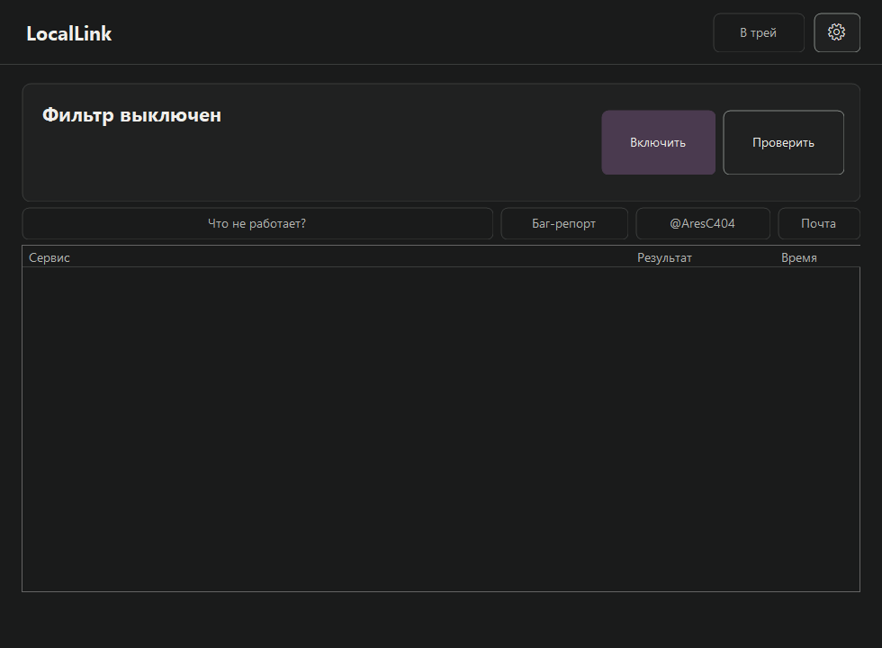

# LocalLink

Приложение для Windows для настройки обхода DPI-блокировок. Подготавливает компоненты, подбирает подключение и запоминает настройки для разных сетей.

**[Скачать LocalLink 0.9.0 для Windows](https://github.com/DrKreck/LocalLink/releases/download/v0.9.0/LocalLink-0.9.0-windows-x64.zip)** · [Все версии](https://github.com/DrKreck/LocalLink/releases) · [Исходники](https://github.com/DrKreck/LocalLink/releases/download/v0.9.0/LocalLink-0.9.0-source.zip)

## Запуск

Windows 10/11 x64, .NET Framework 4.8.

1. Распакуйте Windows-архив и откройте **LocalLink.exe**.
2. Подтвердите подготовку компонентов и запрос прав Windows, если он появится.
3. Нажмите **Включить**, если автоматическое подключение ещё не выбрано.

Компоненты скачиваются из приложения; уже установленные подходящие файлы используются повторно. В «Основном» можно включить подключение при каждом открытии LocalLink.

## Все возможности 0.9.0

### Автоматическая настройка

- Проверка, установка и повторное использование необходимых компонентов с проверкой SHA256.
- Проверка текущего или сохранённого метода; автоматический подбор при необходимости.
- Отдельный метод и отдельный подбор Discord без смены общего метода остальных сервисов.
- Запоминание методов для разных сетей и повторная проверка при подключении.
- Подключение при открытии приложения — по выбранной пользователем настройке.
- Восстановление прежнего профиля после сбоя модуля или сна: до трёх попыток с паузами.
- Отмена подготовки и подбора, ручная остановка соединения и отмена повторных запусков.
- Работающий фильтр не переключает методы сам при смене сети.

### Приложения и режимы

- Встроенные категории Discord, YouTube, Telegram, Steam, Arma Reforger, Tarkov и DCS World.
- Прямое подключение и режимы помощи VPN для TLS/TCP и WireGuard по выбранному IP и порту.
- Пять ручных методов: «Мягкий», «По SNI», «Перестановка», «Фейк + разбиение», «Фейк + перестановка».
- Поиск соединений VPN и выбор обнаруженного узла.
- Возможность разрешить следующий подбор при обнаруженных признаках VPN.
- Дополнительные профили голоса Discord, TCP Telegram и QUIC/HTTP3.

### Telegram Desktop

- Отдельный локальный мост MTProto → TLS/WebSocket для сообщений и файлов.
- Автоматическая подготовка выбранного установленного Telegram и запуск модуля в трее.
- Первое предложение прокси через штатное подтверждение самого Telegram, без изменения файлов аккаунта.
- Ручное подключение, перезапуск и остановка модуля.
- Восстановление соединений модуля после смены физического сетевого подключения.

### Домены и категории

- Включение и отключение категорий по отдельности или всех сразу.
- Поиск доменов, фильтр по категории и постраничный просмотр большого списка.
- Выборочное включение и исключение доменов; правило исключения действует и на поддомены.
- Добавление собственных доменов.
- Загрузка и обновление публичного списка доменов из приложения.

### Пресеты и сети

- Сохранение и загрузка именованных пресетов, сохранение последних настроек.
- Привязка пресета к сети Windows и предложение применить его после смены сети.
- Импорт и экспорт пресетов одним JSON-файлом.
- «Запомнить рабочие» и «Вернуть рабочие».
- Сохранение текущей конфигурации перед импортом или восстановлением.
- Импорт не включает автоподключение и не заменяет локальные привязки сетей или настройки обновлений.

### Проверки и баг-репорты

- Проверки DNS, TCP, TLS и HTTP публичных узлов сервисов.
- Проверки API, обновления, CDN и Gateway Discord.
- Мастер «Что не работает?» для запуска, голоса и файлов Discord, видео YouTube, подключения и звонков Telegram, Steam и игровых подключений.
- ZIP-отчёт с историей событий LocalLink, результатами проверок и подбора; чувствительные адреса не включаются.
- Отдельное сохранение отчёта подбора, подробные этапы проверок и технический журнал.
- Отчёт сохраняется в файл: отправить его можно в Telegram или по почте.

### Интерфейс

- Пять разделов настроек: «Основное», «Приложения», «Профили», «Обновления», «Дополнительно».
- Светлая, тёмная и системная темы, акцент Windows и высокий контраст.
- Сворачивание в трей; открытие, остановка и выход через значок возле часов.
- Добавление и удаление автозапуска приложения.

### Обновления и откат

- Проверка обновлений на GitHub не чаще раза в сутки и отдельная ручная проверка.
- «Обновить», «Позже», «Не напоминать» об этой версии и отключение автоматических предложений.
- Загрузка и установка обновления с сохранением настроек и автоматическим перезапуском.
- Обязательная проверка подписанного RSA-4096/SHA256-манифеста и контрольной суммы архива.
- Сохранение предыдущей версии, ручной откат и возврат при неудачном старте новой версии.
- Журнал прерванной установки и восстановление из резервной копии.
- Отмена установки, в том числе после подготовки помощника обновления.
- Автоподключение ожидает завершения обновления, прежде чем запрашивать права Windows.

## Что проверяется автоматически

Автоподбор проверяет публичные узлы. Голос, работу аккаунта и игровой сеанс проверяют в самих приложениях; игровые категории не являются полным списком IP игровых серверов. Telegram-мост предназначен для сообщений и файлов, не для звонков. У него отдельный значок в трее и независимая остановка.

## Связь и поддержка

[Telegram — @AresC404](https://t.me/AresC404) · [kirill0063@gmail.com](mailto:kirill0063@gmail.com) · [Поддержать на Boosty](https://boosty.to/aresc404)

Если что-то не работает: нажмите **«Что не работает?»** или **«Баг-репорт»**, сохраните ZIP и пришлите его удобным способом. Приложение само отчёты не отправляет.

## Техническая часть

Профили, пресеты, автоподбор, диагностика и установщик находятся в этом репозитории. Обработка трафика использует [zapret2](https://github.com/bol-van/zapret2) и WinDivert; лицензии компонентов — в [THIRD-PARTY.md](THIRD-PARTY.md).

[Изменения](CHANGELOG.md) · [Разработка](CONTRIBUTING.md) · [Приватность](docs/PRIVACY.md) · [MIT](LICENSE) · [Сторонние компоненты](THIRD-PARTY.md)
